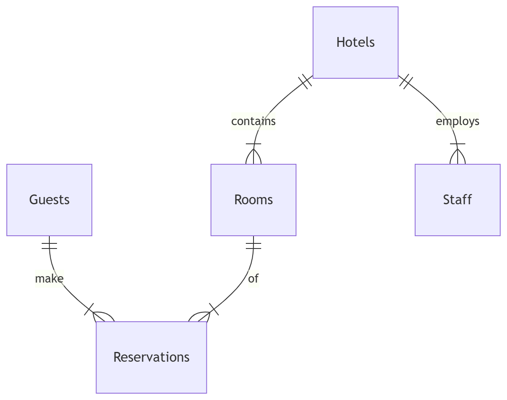

# Design Document

By Youness Ait Hssaine

Video overview: <[URL HERE](https://youtu.be/VFqEGbHHTHk)>

## Scope

The purpose of my database is to manage hotel information in a structured way. It allows us to keep track of hotels, their rooms, staff, guests, and reservations. The main goal is to support typical operations in a hotel system: searching for hotels by location, checking room availability, making reservations, and managing staff and guests.

Inside the scope of the database are:

Hotels: each hotel has a name, city, country, and rating.

Rooms: each room belongs to a hotel, has a number, and can be marked reserved or free.

Staff: employees working at hotels, with roles like manager or receptionist.

Guests: people who make reservations, identified by name and ID card.

Reservations: bookings that connect guests to rooms and hotels, with dates and amounts.

Outside the scope are things like:

Payment processing (credit card transactions, billing systems).

Complex scheduling like partial‑day reservations or overlapping stays.

External services such as airline bookings or restaurant reservations.

Detailed HR management for staff (salaries, shifts, performance).

This keeps the project focused on the hotel core operations without overcomplicating it.

## Functional Requirements

A user should be able to:

Search for hotels by country and city.

View available rooms in a specific hotel.

Make reservations for guests, including check‑in and check‑out dates.

Add new staff members to hotels.

Add new guests to the system.

Beyond the scope:

Users cannot process payments or refunds.

Users cannot manage advanced analytics like occupancy rates over time.

Users cannot handle external integrations (airlines, restaurants, etc.).

Users cannot manage detailed staff payroll or HR records.

This keeps the database simple but functional for the most common hotel operations.

## Representation

### Entities

The entities I chose are:

#### Hotels:
attributes are id, name, city, country, rating.

## Types: 
TEXT for names and locations, NUMERIC for rating.

## Constraints: 
PRIMARY KEY(id) and UNIQUE(name) to avoid duplicates.

#### Rooms: 
attributes are id, hotel_id, number, reserved.

## Types: 
INTEGER for IDs and numbers, CHECK(reserved IN (0,1)) for reserved flag.

## Constraints: 
FOREIGN KEY(hotel_id) with ON DELETE CASCADE so rooms are deleted if the hotel is deleted. UNIQUE(hotel_id, number) ensures no duplicate room numbers in the same hotel.

#### Staff: 
attributes are id, name, hotel_id, role.

## Types: 
TEXT for names and roles.

## Constraints: 
FOREIGN KEY(hotel_id) with ON DELETE CASCADE.

#### Guests: 
attributes are id, name, card_id.

## Types: 
TEXT for name and card_id.

## Constraints: 
PRIMARY KEY(id).

#### Reservations: 
attributes are id, guest_id, room_id, hotel_id, reservation_date, check_in, check_out, amount.

## Types: 
DATE for dates, REAL for amount.

## Constraints: 
foreign keys to guests, rooms, and hotels with ON DELETE CASCADE.

I chose these types because they are simple and match the nature of the data. Constraints enforce integrity: for example, cascading deletes prevent orphan records, and unique constraints prevent duplicates.

### Relationships

Hotels <-> Rooms: one hotel has many rooms.

Hotels <-> Staff: one hotel has many staff members.

Rooms <-> Reservations: one room can have many reservations over time.

Guests <-> Reservations: one guest can make many reservations.

These relationships are enforced with foreign keys. The ER diagram shows hotels at the top right, connected to rooms, staff, and reservations, while reservations also connect to guests.

## Optimizations

I created two main optimizations:

### Indexes

hotels_location on (country, city) speeds up queries that search hotels by location.

rooms_reserved on (reserved) speeds up queries that filter available rooms.

### Views

available_rooms view shows all rooms that are not reserved, joined with hotel details.

This makes queries simpler and more user‑friendly, since users don’t need to write joins every time.

These optimizations were chosen because they directly support the most common queries: searching for hotels, finding available rooms, and making reservations.

## Limitations

Some limitations of the design:

The reserved flag in rooms is simplistic. In reality, availability depends on reservation dates, not just a binary flag. A room could be reserved for one week but free the next, which is not represented here.

The schema does not handle overlapping reservations or partial‑day bookings.

Guests are identified only by name and card_id, which may not be representetive enough in real life. A more robust system would add emails or passport numbers.

Staff management is minimal: only name and role are stored, no salaries, schedules, or departments.

The database does not handle payments, invoices, or external integrations.

Despite these limitations, the design is solid for a learning project. It demonstrates relational design, constraints, indexes, and views, while keeping the scope manageable.

# Conclusion
In conclusion, this database design provides a clear and practical framework for managing hotels, rooms, staff, 
guests, and reservations. It demonstrates how relational models can enforce integrity through foreign keys and constraints, while also showing how indexes and views improve usability and performance. Although simplified 
compared to real‑world hotel systems, the schema captures the essential operations and offers a strong foundation 
for CRUD functionality. As a final project, it balances scope and complexity well, and it highlights the importance of thoughtful design choices in building reliable databases.
